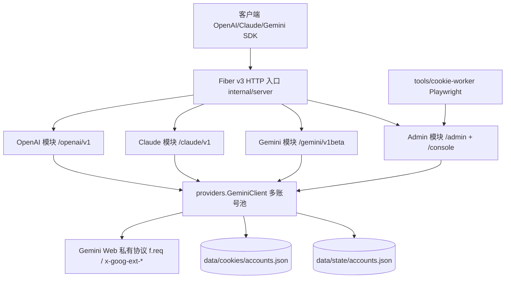

# 系统架构全景（Architecture Overview）

> 真理源：`go.mod`、`cmd/server/main.go`、`internal/server/server.go`、`internal/modules/combine_module.go`、
> 各 `*_module.go`、`internal/commons/configs/configs.go`、`Dockerfile`、`docker-compose.yml`。
> 本文档只写“看代码看不出来的”边界与链路，不写函数级细节。

## 1. 系统全景

技术栈（`go.mod` 实测）：Go 1.25.1 + Fiber v3.2.0 + uber/fx 1.24.0（DI）+ zap 日志 + req/v3 + godotenv。
启动入口 `cmd/server/main.go`：`fx.New(configs.New, logger, server.Module, modules.Module)`，30s 启动/停止超时。

## 2. 模块划分与依赖边界

- **接入层（`internal/server/`）**：只做 Fiber 装配、CORS/recover/限流、`/health`、`/ready`、`/console`、`/docs`、`/openapi.json`、404 与生命周期。禁止在这里解析 Gemini Web 字节。
  - `GET /health` 仅表示进程存活；`GET /ready` 至少一个账号健康才 200，否则 503，只返回总数/健康数等非敏感字段。
  - 限流默认开启（`RATE_LIMIT_ENABLED=true`），但 `/console`、`/docs`、`/openapi.json`、`/health` 与 `/admin/*` 跳过限流。
  - `console.html`、`openapi.json` 通过 `go:embed` 编入二进制。
- **协议适配层（`internal/modules/openai|claude|gemini/`）**：各模块 `Module = fx.Options(Provide Service, Provide Controller, Invoke RegisterRoutes)`，路由前缀固定：
  - OpenAI：`/openai/v1/models`、`POST /chat/completions`、`POST /images/generations`、`/files*`（`requireFileToken` 强制 `COOKIE_SYNC_TOKEN`，支持 `Authorization: Bearer` 或 `X-Cookie-Sync-Token`）。
  - Claude：`/claude/v1/models`、`/models/:model_id`、`POST /messages`、`POST /messages/count_tokens`。
  - Gemini：`/gemini/v1beta/models`、`POST /models/:model\:generateContent`、`POST /models/:model\:streamGenerateContent`。
  - 禁止适配层直接拼 `f.req` 或解析上游原始流字节，只允许调用 `providers` 接口并转换 DTO/SSE。
- **Provider 层（`internal/modules/providers/`）**：唯一拥有 Gemini Web 语义的地方——Cookie、`f.req` 构造、上游流解析、会话元数据、账号选择与故障转移。
  - `Provider` 接口：`Init / GenerateContent / StartChat / Close / GetName / IsHealthy / ListModels`；`ClientPool` 额外暴露 `GenerateContentStreamForOpenAI`、`HasConversationState`、`IsConversationUntrusted`。
  - 已有会话固定绑定首次使用的账号，轮换只影响新会话；`Init` 在后台 goroutine 执行，HTTP 先监听，初始化失败由后台刷新自动恢复。
- **管理面（`internal/modules/admin/` + `internal/server/console.go`）**：`/admin/accounts*`（增删改查、cookies/proxy/refresh/test）、`POST /admin/proxy-test`、`/admin/requests*`、`GET|POST /admin/settings`（运行时开关 + 只读有效配置）。所有管理写操作需管理 Token：优先 `COOKIE_SYNC_TOKEN`，未设置时由 `configs.New` 自动生成并持久化到 `data/state/admin-token`（0600）。控制台是单文件 SPA，直接调 `/admin/*`。
- **配置（`internal/commons/configs/`）**：`godotenv.Overload()` 加载 `.env`（`.env` 优先于陈旧 shell 环境变量）。`PORT` 默认 `8787`；**账号池允许为空启动**——控制台是添加首个账号的主入口，账号经 `data/cookies/accounts.json` 在重启后恢复。`GEMINI_1PSID` / `GEMINI_ACCOUNTS` 仍用于配置文件声明账号，与控制台账号共存。
- **外部 Worker（`tools/cookie-worker/`，Node + Playwright）**：全账号不可用时的兜底，调用 `/admin/accounts/:id/cookies` 回填。Docker 单镜像不含 Node/Chromium，`docker-compose.yml` 已强制 `GEMINI_COOKIE_WORKER_ENABLED=false`。

## 3. 关键数据流

- 对话主链路：`POST /openai/v1/chat/completions` → `OpenAIController`（BOM 裁剪、绑定 DTO、SSE 帧）→ `OpenAIService.CreateChatCompletionStream`（提示词组装、上下文规划、工具桥接判定、provider 事件转 OpenAI chunk）→ `ClientPool` 选账号 → `gemini_service` 发 Gemini Web 流 → 实时转发 delta，以 `data: [DONE]` 收尾。
- 工具调用是 prompt 桥接，不是 Gemini Web 原生工具调用；无 `tools` 字段时完全跳过桥接，保持最快纯流式路径。
- 多轮上下文：显式 `conversation_id` 复用优先；否则按“完整历史指纹 → 尾部历史 → 最近 2-4 条 user 窗口 → 根话题指纹”容忍客户端截断；不可信会话（cid 不一致、Bard 1097/1060 类错误）用本地完整历史重建并迁移到新 Gemini 话题。
- 文件：`POST /openai/v1/files` 落盘 `data/openai-files`，`OPENAI_FILE_MAX_BYTES` 默认 32MiB，总量默认 1GiB，TTL 默认 24h；messages 内用 `file_id` 引用，上游发送前并行上传（并发度 4）。

## 4. 核心抽象与设计模式

- fx 依赖注入组装一切：`server.Module` 提供 HTTP，`modules.Module` 聚合 admin/gemini/claude/openai/providers。
- `GenerateOption` 函数选项（`WithModel / WithThinkingLevel / WithConversationID / WithSourcePath / WithInputFiles / WithIncognito`）是跨层唯一参数通道。
- 模型名以 `resolveModels` 的 canonical 集为准：`gemini-4-argon`、`gemini-3.8-flash`、`gemini-3.5-flash-lite`、`gemini-3.1-pro`；旧名 `gemini-3.6-flash`、`gemini-3.5-flash`、`gemini-3.1-flash-lite` 仅作兼容别名，不在 `/models` 暴露。
- 运行时开关：`providers.RuntimeSettings`（`runtime_settings.go`）是唯一可变态，控制台 `GET|POST /admin/settings` 写、请求路径读，`.env` 的 `GEMINI_INCOGNITO` 只作启动默认；`incognito_source` 区分 `env`/`runtime`。
- Thinking 档位链路：`reasoning_effort / thinking_level` → `WithThinkingLevel` → `x-goog-ext-525001261-jspb[15]` 与 `f.req.inner[80]`（2026-10-14 网页基线：Low=1、Medium=4、High=2；旧名 Standard=1、Extended=2 仍兼容）。`GEMINI_USE_SOURCE_PATH` 默认 false，只在 A/B 排查时开。
- 调试抓包默认全关（`OPENAI_DEBUG_REQUEST_LOG / GEMINI_TRACE_STREAM / GEMINI_DEBUG_STREAM_DIR` 等），抓包必须脱敏 Cookie 与鉴权头。

## 5. 外部依赖与集成点

- 上游：Gemini Web 私有协议（`f.req`、92 项 inner 数组、`c/r/rc/context token`），以抓包和回归测试为准，不是稳定契约。
- 本地代理：`PROXY_URL` 只用于单账号默认；多账号优先各自 `GEMINI_ACCOUNT_<ID>_PROXY`，支持 `http://` 与 `socks5h://`；容器内访问宿主机代理必须用 `host.docker.internal`。
- 持久化（`docker-compose.yml` 挂载）：`./data`（Cookie 缓存 + 账号轮换状态 + 自动生成的管理 Token）、`./.cookies`（硬编码 jar 目录）、`./.env:ro`（改配置后 `docker compose restart` 即可，无需重建）。
- 健康检查：compose 用真实 `GET /health`（禁止 `wget --spider` 发 HEAD，Fiber 该路由 GET-only 会误判 unhealthy）。

## 6. 技术债务与已知取舍

- 依赖非公开协议，网页结构变化会导致漂移；已设 `docs/upstream-protocol-drift-runbook.md` 为标准排查入口（网页基线 → 本地 raw/SSE 分层对照），改协议前先抓同一时间、同一账号、同一模型的网页基线。
- Provider `Init` 多账号串行 Rotate 可能耗时数十秒，取舍是“先监听、后台初始化 + 后台刷新自愈”，代价是刚启动瞬间请求可能鉴权失败。
- 工具桥接阶段需缓冲上游输出判 JSON/正文，不保证连续真流式；客户端除非确需工具，否则不要传 `tools`。
- `scratch/`、`.codegraph/`、各类抓包与日志已在 `.gitignore` 忽略，排查产物禁止入库。
