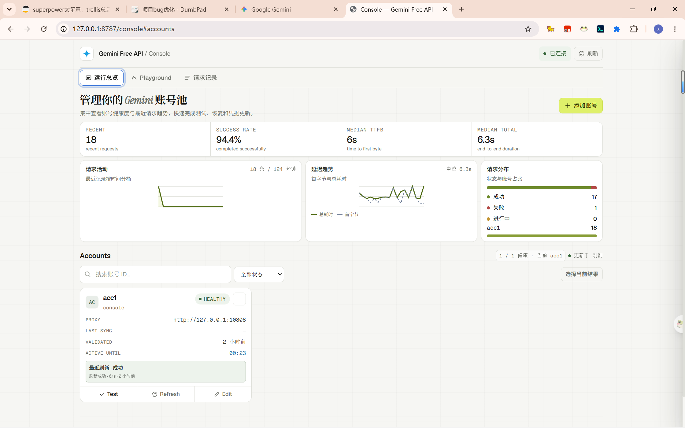
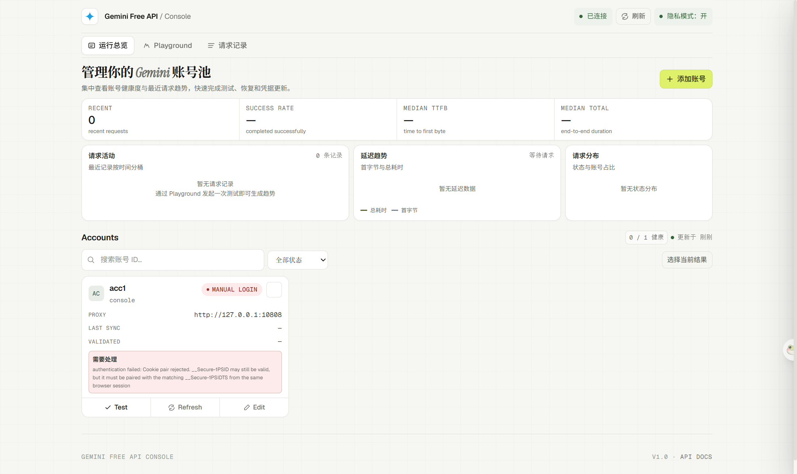
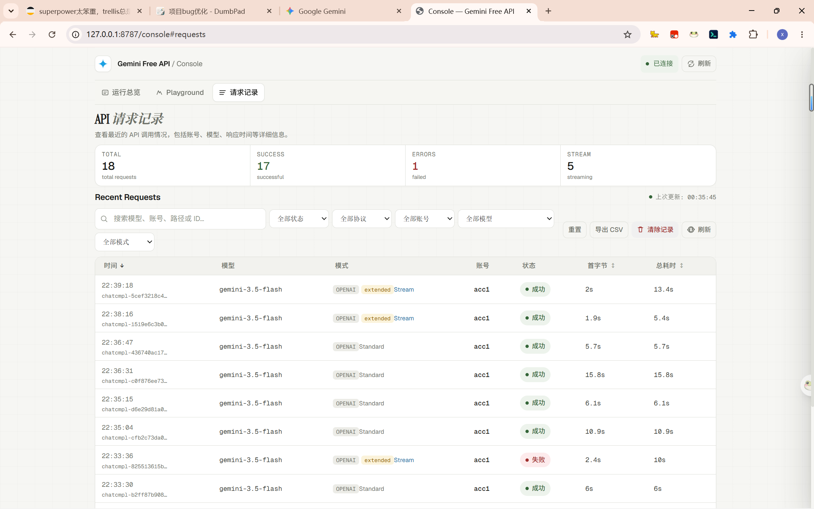

# Gemini Web API 

把 Gemini 网页端封装成 OpenAI / Claude / Gemini 兼容接口的本地代理服务。

基于网页端逆向实现，依赖 Google Gemini Web 的私有请求结构。适合个人研究和本地客户端接入。

> **已对齐网页端 2026-10-14 最新版本**：新增支持 **Gemini 4 Argon**（复杂任务模型），思考档位升级为 **Low / Medium / High** 三档；三个旧模型（3.8 Flash / 3.5 Flash-Lite / 3.1 Pro）ID 与模式值保持不变。

## 能力概览

| 能力 | OpenAI | Claude | Gemini 原生 |
|:---|:---:|:---:|:---:|
| 文本对话 | ✅ | ✅ | ✅ |
| 流式输出 | **实时流** | **实时流** | **实时流** |
| Thinking Level（Low / Medium / High） | ✅ | — | — |
| 多轮上下文 | 实验性 | — | — |
| 图片/文件输入 | ✅ | ✅ | ✅ |
| 工具调用 | 实验性桥接 | 桥接 | 桥接 |
| 隐私模式（网页端不留记录） | ✅ | ✅ | ✅ |

## 快速开始

```bash
cp .env.example .env   # 可选：不创建也能启动，常用项都有默认值
go run cmd/server/main.go
```

服务默认监听 `http://localhost:8787`，API 文档 `http://localhost:8787/docs`。

首次启动**不需要填写任何 Cookie**，系统会：

1. 自动生成管理 Token，打印在启动日志中，并保存到 `data/state/admin-token`（权限 0600）；
2. 以空账号池启动，`/health` 正常、`/ready` 返回 503（还没有可用账号）；
3. 等你在 Web 控制台添加第一个账号。

### 3 步完成账号接入

1. 打开 `http://localhost:8787/console`，粘贴启动日志或 `data/state/admin-token` 中的管理 Token。
2. 浏览器登录 [gemini.google.com](https://gemini.google.com/)，按 `F12` → **Application** → **Cookies**，复制 `__Secure-1PSID` 所在的那整段 Cookie。
3. 控制台点「添加账号」，把整段 Cookie 粘进「Cookie」框保存；`__Secure-1PSIDTS` 会自动拆分，也可以留空由系统轮换。

账号会保存到 `data/cookies/accounts.json`，重启后自动恢复，不需要再改配置文件。存活检查 `GET /health`；账号就绪检查 `GET /ready`（无健康账号时返回 503）。

> 想让 Token 固定下来：在 `.env` 设置 `COOKIE_SYNC_TOKEN=...`，或用 `ADMIN_TOKEN_PATH` 指定 Token 文件路径。公网部署建议显式设置。

### 常用默认值

| 项目 | 默认值 | 修改方式 |
|:---|:---|:---|
| 端口 | `8787` | `.env` 的 `PORT` |
| 限流 | 开启，60s 内 30 次 | `RATE_LIMIT_*` |
| Cookie 自动刷新 | 1440 分钟 | `.env` 的 `GEMINI_REFRESH_INTERVAL` |
| 控制台新增账号的停留时长 | 180 分钟 | 新增账号时自动采用 |
| 隐私模式 | 关闭 | 控制台顶栏开关（立即生效）或 `GEMINI_INCOGNITO=true` |
| 全局代理 | 直连 | `.env` 的 `PROXY_URL`（控制台新增账号留空时自动继承） |

### 可选：用配置文件声明账号

仍然支持 `GEMINI_1PSID` / `GEMINI_ACCOUNTS`，适合 Docker Compose、CI，或希望账号随配置版本化的场景；控制台添加的账号与它们共存，优先级由 `PRIORITY` 控制。完整变量列表见 [`docs/technical-details.md`](docs/technical-details.md) 与 `.env.example`。

```env
# 单账号
GEMINI_1PSID=你的 __Secure-1PSID
GEMINI_1PSIDTS=可选，留空自动轮换

# 或多账号
GEMINI_ACCOUNTS=main,backup1
GEMINI_ACCOUNT_MAIN_1PSID=主号 __Secure-1PSID
GEMINI_ACCOUNT_MAIN_PRIORITY=3
GEMINI_ACCOUNT_BACKUP1_1PSID=备用号 __Secure-1PSID
```

> Docker 环境下代理地址用 `http://host.docker.internal:10808`，`docker-compose.yml` 已内置映射。

## Web 控制台

访问 `http://localhost:8787/console`，用管理 Token 登录（未设置 `COOKIE_SYNC_TOKEN` 时使用启动日志 / `data/state/admin-token` 中的自动生成值）。



控制台功能：

- 账号列表：状态、代理、同步时间、健康度
- 添加 / 编辑 / 删除账号
- Cookie 更新会先验证，验证失败时保留原有可用 Cookie
- 账号测试：发送真实对话消息验证可用性
- 调用记录，方便查看实际情况
- 代理测试：验证代理连通性

### Playground

控制台内置 Playground 聊天界面，支持模型切换、Thinking Level 调节和流式对话测试。


### 隐私模式

对齐 Gemini 网页端「临时对话」（Temporary chat）：**网页端不留记录**（侧栏不新增会话），该轮也不用于模型改进。

控制台**顶栏的「隐私模式」开关**与 `.env` 的 `GEMINI_INCOGNITO` 是**同一个开关**：点一下立即对所有后续请求生效，无需改配置文件、无需重启。来源显示在按钮提示中（「控制台运行时设置」或「.env GEMINI_INCOGNITO」），重启后回落到 `.env` 默认值。



两种开启方式，效果等价：

| 方式 | 用法 |
|:---|:---|
| 控制台 | 顶栏点「隐私模式」开关，立即全局生效 |
| 配置文件 | `.env` 设 `GEMINI_INCOGNITO=true`（默认值，重启后生效） |

```env
GEMINI_INCOGNITO=false   # 默认关闭
```

> 此外三协议请求体仍支持单请求 `"incognito": true`（OpenAI / Claude / Gemini），与全局开关是**或**关系——任一开启即走隐私路径。

**续聊语义不变**：同一 `conversation_id` 仍映射到同一 Gemini 侧会话，多轮上下文照常可用，只是网页端不出现记录。

上游请求差异（与网页端单变量基线逐位对齐）：

| 位置 | 隐私关 | 隐私开 |
|:---|:---|:---|
| `f.req` inner[45] | `null` | `1` |
| `f.req` inner[67] | `null` | `0` |
| `x-goog-ext-525001261-jspb`[7] | `0` | `1` |

### 调用记录




## 调用示例

### 流式对话

**OpenAI 格式**：

```bash
curl http://localhost:8787/openai/v1/chat/completions \
  -H "Content-Type: application/json" \
  -d '{
    "model": "gemini-3.8-flash",
    "stream": true,
    "messages": [{"role": "user", "content": "你好"}]
  }'
```

**Claude 格式**：

```bash
curl http://localhost:8787/claude/v1/messages \
  -H "Content-Type: application/json" \
  -d '{
    "model": "gemini-3.8-flash",
    "stream": true,
    "max_tokens": 1024,
    "messages": [{"role": "user", "content": "你好"}]
  }'
```

**Gemini 原生格式**：

```bash
curl http://localhost:8787/gemini/v1beta/models/gemini-3.8-flash:streamGenerateContent \
  -H "Content-Type: application/json" \
  -d '{
    "contents": [{"parts": [{"text": "你好"}]}]
  }'
```

三种格式均支持真正的流式输出（real streaming），通过 provider 原生 stream 能力实时转发 delta，无需等待完整响应。

### Thinking Level

```json
{
  "model": "gemini-3.8-flash",
  "reasoning_effort": "high",
  "stream": true,
  "messages": [{"role": "user", "content": "详细分析这个问题"}]
}
```

| 参数 | 值 | 对应 |
|:---|:---|:---|
| `reasoning_effort` | `low` / `medium` / `high` | 网页端 Low / Medium / High 三档 |
| `thinking_level` | `low` / `medium` / `high` | 直接映射（旧名 `standard`＝`low`、`extended`＝`high`） |

### 文件上传

```bash
curl http://localhost:8787/openai/v1/files \
  -H "Authorization: Bearer $COOKIE_SYNC_TOKEN" \
  -F purpose=assistants \
  -F file=@./note.txt
```

文件 API 使用 `COOKIE_SYNC_TOKEN` 鉴权。返回 `file_id` 后在 messages 中引用：

```json
{
  "role": "user",
  "content": [
    {"type": "input_text", "text": "总结这个文件"},
    {"type": "input_file", "file_id": "file-...", "filename": "note.txt"}
  ]
}
```

### Python SDK

```python
from openai import OpenAI

client = OpenAI(base_url="http://localhost:8787/openai/v1", api_key="not-needed")

stream = client.chat.completions.create(
    model="gemini-3.8-flash",
    stream=True,
    messages=[{"role": "user", "content": "你好"}],
)

for chunk in stream:
    if chunk.choices[0].delta.content:
        print(chunk.choices[0].delta.content, end="", flush=True)
```

## 模型列表

| 模型名 | 说明 |
|:---|:---|
| `gemini-3.8-flash` | UI 默认 Flash（兼容旧名 `gemini-3.6-flash`、`gemini-3.5-flash`） |
| `gemini-3.5-flash-lite` | UI Flash-Lite（兼容旧名 `gemini-3.1-flash-lite`） |
| `gemini-3.1-pro` | UI Pro |
| `gemini-4-argon` | UI 4 Argon（复杂任务） |

需要深度思考时使用 Thinking Level 参数，而非依赖模型名后缀。

## 性能与可靠性

### 已优化项

| 优化点 | 修复前 | 修复后 | 影响 |
|:---|:---|:---|:---|
| 流式解析 O(n²) | 每个 16KB chunk 全量重扫 512KB 缓冲区 | 8KB 增量节流，仅在足够新数据到达时重解析 | 长回复 CPU 开销降低 ~94% |
| 会话读锁竞争 | `conversationID` / `IsConversationUntrusted` 等用写锁 (`Lock`) 做纯读操作 | 改用 `RLock` / `RUnlock`，读操作不再互斥 | 高并发下吞吐量显著提升 |
| Timer GC 压力 | 流式循环每次迭代 `time.NewTimer` | 循环外创建一次，循环内 `Reset` 复用 | 减少 GC 压力和内存分配 |
| HTTP 客户端复用 | `refreshSessionToken` 每次创建新 `req.Client` 和 `http.Client` | 复用 `httpClient` 和 `rawHTTPClient`，连接池保持 | 减少 TLS 握手，降低刷新延迟 |
| 文件上传并行化 | 多文件串行上传 | goroutine 并行上传（并发度 4），保持顺序 | 多文件场景延迟降低 ~75% |
| Cookie 缓存原子写 | `os.WriteFile` 非原子，崩溃可能损坏 | 临时文件 + `os.Rename` 原子替换 | 杜绝缓存文件损坏 |
| `conversationTo` 内存泄漏 | map 无限增长 | 12h TTL 自动清理 | 长期运行内存稳定 |
| toolBridge/toolPlanner 清理 | `pruneTranscriptContextsLocked` 遗漏这三组 map | 补全 TTL 清理 | 防止上下文缓存内存泄漏 |
| `Close()` 双关 panic | 多次调用 `close(stopRefresh)` panic | `sync.Once` 保护 | 杜绝 panic |
| `generateChatID` 碰撞 | `math/rand` 可能碰撞 | `crypto/rand` 24 字符 hex | 彻底消除碰撞 |
| Claude/Gemini 假流式 | 先获取完整响应再逐字模拟，首字节延迟极大 | 调用 provider 原生 stream 接口实时转发 delta | 三种格式首字节延迟一致 |
| Claude SSE 格式不规范 | 仅发送 `data:` 行，缺少 `event:` 行 | 使用 `SendSSEChunk` 同时发送 `event:` + `data:` | 符合 Anthropic API 规范 |
| Claude `Index=0` 丢失 | `int` + `omitempty` 导致序列化省略 index=0 | 改用 `*int` 指针类型 | 第一个内容块的 index 正确输出 |
| 流式错误检查顺序错误 | 出错时先发送空内容块再返回错误 | 出错时直接返回错误，不发送空内容 | 客户端不再收到误导性空内容 |
| Claude/Gemini 日志静默丢弃 | module 未调用 `SetLogger`，一直使用 NopLogger | module 的 `RegisterRoutes` 注入 logger | 错误日志正常输出 |
| Claude controller data race | `SetLogger` 无锁保护 | 添加 `sync.RWMutex` | 杜绝并发读写竞态 |

### Benchmark 结果

```
BenchmarkExtractStreamTextFromBuffer-12    256KB buffer    ~4.5ms/op   36-40 MB/s
BenchmarkHasConversationStateRLock-12      1000 entries    20.87 ns/op  0 allocs
BenchmarkPruneConversationsLocked-12       1000 entries    220μs/op
BenchmarkGenerateChatID-12                 crypto/rand     240 ns/op    88 B/op
```

## Docker 部署

### 快速启动

```bash
# 1. 复制环境配置（可留空，常用项都有默认值）
cp .env.example .env
# 可选：设置 COOKIE_SYNC_TOKEN、PROXY_URL；Cookie 建议到控制台添加

# 2. 启动服务
docker compose up -d --build

# 3. 查看日志，复制自动生成的管理 Token
docker compose logs -f
```

服务启动后访问：
- API 端点：`http://localhost:8787/openai/v1/chat/completions`
- Web 控制台：`http://localhost:8787/console`（粘贴日志中的 Token 后添加账号）
- API 文档：`http://localhost:8787/docs`

自动生成的 Token 同时保存在挂载卷 `./data/state/admin-token` 中，重启后保持不变。

### 配置说明

控制台是推荐入口：启动后添加账号、切换隐私模式、测试代理都不需要改 `.env`。下面两种写法仅用于希望账号随配置版本化或无人值守部署的场景。

#### 单账号模式

```env
COOKIE_SYNC_TOKEN=your_secure_token
GEMINI_1PSID=your__Secure_1PSID_cookie
GEMINI_1PSIDTS=your__Secure_1PSIDTS_cookie  # 可选
```

#### 多账号模式（推荐）

```env
COOKIE_SYNC_TOKEN=your_secure_token
GEMINI_ACCOUNTS=acc1,acc2,acc3

GEMINI_ACCOUNT_ACC1_1PSID=xxx
GEMINI_ACCOUNT_ACC1_PRIORITY=3
GEMINI_ACCOUNT_ACC1_PROXY=http://host.docker.internal:10808

GEMINI_ACCOUNT_ACC2_1PSID=xxx
GEMINI_ACCOUNT_ACC2_PRIORITY=2
```

### 网络配置

| 场景 | 代理地址写法 |
|:---|:---|
| 宿主机代理 (Windows/Mac) | `http://host.docker.internal:10808` |
| 宿主机代理 (Linux) | `http://172.17.0.1:10808` |
| 容器内 Clash | `http://clash:7890` |
| 无代理 | 留空 |

### 数据持久化

| 挂载路径 | 说明 | 建议 |
|:---|:---|:---|
| `./data` | Cookie 缓存、账号状态、自动生成的管理 Token | 必须持久化 |
| `./.env` | 配置文件（只读挂载），可只写 `COOKIE_SYNC_TOKEN` / `PROXY_URL` | 修改后 `docker compose restart` 生效 |
| `./.cookies` | Cookie jar 文件 | 可选 |

### 构建特性

- **多阶段构建**：分离编译和运行环境，镜像体积更小
- **BuildKit 缓存**：Go 模块缓存挂载，重复构建更快
- **国内加速**：默认使用 `GOPROXY=goproxy.cn`
- **静态资源嵌入**：`console.html` 通过 `go:embed` 编入二进制

## Admin API

所有 `/admin/*` 请求需带管理 Token（`Authorization: Bearer <token>` 或 `X-Cookie-Sync-Token`）。Token 优先取 `COOKIE_SYNC_TOKEN`；未设置时使用 `data/state/admin-token` 中自动生成的值。

```bash
# 列出账号
curl http://localhost:8787/admin/accounts -H "Authorization: Bearer $TOKEN"

# 添加账号
curl -X POST http://localhost:8787/admin/accounts \
  -H "Content-Type: application/json" \
  -H "Authorization: Bearer $TOKEN" \
  -d '{"account_id":"acc3","secure_1psid":"...","proxy_url":"..."}'

# 测试账号
curl -X POST http://localhost:8787/admin/accounts/acc1/test -H "Authorization: Bearer $TOKEN"

# 保存 Cookie（202 表示已落盘，账号状态会在后台完成验证）
curl -X POST http://localhost:8787/admin/accounts/acc1/cookies \
  -H "Content-Type: application/json" \
  -H "Authorization: Bearer $TOKEN" \
  -d '{"secure_1psid":"...","secure_1psidts":"...","source":"console"}'

# 测试代理
curl -X POST http://localhost:8787/admin/proxy-test \
  -H "Content-Type: application/json" \
  -H "Authorization: Bearer $TOKEN" \
  -d '{"proxy_url":"http://host.docker.internal:10808"}'
```

## 技术栈

Go 1.25.1 + Fiber v3.2.0 + uber/fx 1.24.0（DI 组装）+ zap 日志 + req/v3 + godotenv（见 `go.mod`）。
Node 仅用于 `tools/cookie-worker`（Playwright Cookie Worker），主服务无 `package.json`。

## 项目结构

- `cmd/server/` — 唯一入口（`fx.New` 组装）与 DI 图校验测试
- `internal/server/` — Fiber 装配：`/health`、`/ready`、`/console`、`/docs`、`/openapi.json`、限流与 404
- `internal/modules/openai|claude|gemini/` — 三协议适配（前缀 `/openai/v1`、`/claude/v1`、`/gemini/v1beta`）
- `internal/modules/providers/` — Gemini Web 语义唯一所有者（`f.req`、流解析、账号池）
- `internal/modules/admin/` — `/admin/*` 账号与请求记录管理
- `internal/commons/configs/` — 配置唯一入口（`.env` + `GEMINI_*`）
- `tools/e2e/` — 黑盒回归；`tools/cookie-worker/` — Playwright 兜底 Worker
- `docs/` — 维护者文档；`docs/archive/` — 本地过期存档（永不提交）

## 相关文档

- 架构说明：`ARCHITECTURE.md`
- 更新日志：`CHANGELOG.md`
- AI 协作规范：`AGENTS.md`（仅本地，永不提交）
- 技术细节与环境变量全表：`docs/technical-details.md`
- 改动入口：`docs/core-bridge-handoff.md`
- 流式链路：`docs/openai-gemini-stream-pipeline.md`
- 上游协议漂移排查：`docs/upstream-protocol-drift-runbook.md`

## 开发

```bash
go test ./...
```

维护者文档：

- [技术细节](docs/technical-details.md) — 多轮上下文、工具桥接、Cookie 快速同步与 Worker、容错策略、排错开关、环境变量完整列表
- [Core Bridge Handoff](docs/core-bridge-handoff.md) — 核心边界和改动入口
- [Stream Pipeline](docs/openai-gemini-stream-pipeline.md) — 完整流程说明
- [上游协议漂移排查手册](docs/upstream-protocol-drift-runbook.md) — Thinking 字段校准、Chrome 抓包、分层诊断和敏感数据清理

## 说明

本项目基于[ntthanh2603/gemini-web-to-api](https://github.com/ntthanh2603/gemini-web-to-api) ，后重塑了主要功能，优化了整个请求链路，保留了部分特性。Gemini 网页端结构可能变化，涉及 `f.req`、`x-goog-ext-*`、`c/r/rc/context token` 的行为以抓包和回归测试为准。


### 健康检查与 Kubernetes

- `GET /health` 是 liveness，只表示进程存活，适合 Docker Compose，避免 Cookie 暂时失效导致重启循环。
- `GET /ready` 是 readiness；至少一个 Gemini 账号健康时返回 200，否则返回 503，并仅包含账号总数、健康数和非敏感状态。

```yaml
livenessProbe:
  httpGet:
    path: /health
    port: 8787
readinessProbe:
  httpGet:
    path: /ready
    port: 8787
```

### 文件存储限制

| 环境变量 | 默认值 | 说明 |
|---|---:|---|
| `OPENAI_FILE_MAX_BYTES` | `33554432` | 单个上传、Base64 或远程附件最大字节数 |
| `OPENAI_FILE_STORE_MAX_BYTES` | `1073741824` | `data/openai-files` 总容量上限 |
| `OPENAI_FILE_TTL_HOURS` | `24` | 文件保留小时数；启动和上传前清理过期及孤立文件 |
